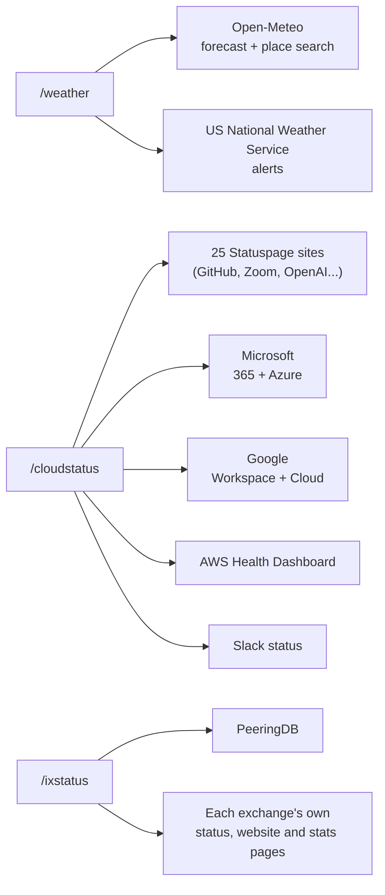

# Data sources

Where each server gets its data. Every source is a free public endpoint that
needs no account, except one optional key for PeeringDB.

## /weather

| Source | Status page or home | Endpoint used | Covers | Terms |
|---|---|---|---|---|
| Open-Meteo forecast | https://open-meteo.com | `https://api.open-meteo.com/v1/forecast` | Current conditions and up to 16 days of forecast, worldwide | CC BY 4.0, free non-commercial use |
| Open-Meteo geocoding | https://open-meteo.com | `https://geocoding-api.open-meteo.com/v1/search` | Turning a place name into coordinates (`geocode`, and `place` in the other tools) | CC BY 4.0, data from GeoNames |
| US National Weather Service | https://www.weather.gov | `https://api.weather.gov/alerts/active` | Active watches, warnings and advisories for the US and its territories only | Public domain |

## /cloudstatus

### Big providers (their own feeds)

| Provider | Status page | Endpoint used | Covers | Ask for it as |
|---|---|---|---|---|
| Microsoft 365 (consumer) | https://status.cloud.microsoft | `https://status.cloud.microsoft/api/posts/m365Consumer` | Outlook.com and Hotmail, OneDrive, Teams Free, Office on the web (Word, Excel, PowerPoint), Copilot, To Do | `outlook`, `hotmail`, `onedrive`, `teams`, `office`, `copilot`, `m365` |
| Microsoft 365 (admin center) | https://status.cloud.microsoft | `https://status.cloud.microsoft/api/posts/mac` | Microsoft's public notice when the business admin center itself has problems. Health of a specific business tenant (Exchange Online, SharePoint, Teams for work) isn't public: it's only visible inside that company's admin center | `exchange`, `sharepoint`, `m365 business` |
| Microsoft Azure | https://azure.status.microsoft/en-us/status | `https://rssfeed.azure.status.microsoft/en-us/status/feed/` (RSS) | Active Azure incidents in all regions | `azure` |
| Google Workspace | https://www.google.com/appsstatus/dashboard/ | `https://www.google.com/appsstatus/dashboard/incidents.json` | Gmail, Drive, Docs, Sheets, Meet, Calendar, Chat | `gmail`, `drive`, `docs`, `sheets`, `meet`, `calendar`, `google` |
| Google Cloud | https://status.cloud.google.com | `https://status.cloud.google.com/incidents.json` | All Google Cloud products and regions | `gcp`, `google cloud` |
| Amazon Web Services | https://health.aws.amazon.com/health/status | `https://health.aws.amazon.com/public/currentevents` | Current events for every AWS service and region | `aws` |
| Slack | https://slack-status.com | `https://slack-status.com/api/v2.0.0/current` | Messaging, calls, login, files, workflows | `slack` |

### Statuspage sites

These use Atlassian Statuspage, so the server reads the same
`<status page>/api/v2/summary.json` from each one. It covers overall status,
degraded components, active incidents and maintenance in progress.

| Service | Status page | Ask for it as |
|---|---|---|
| GitHub | https://www.githubstatus.com | `github` |
| Zoom | https://www.zoomstatus.com | `zoom` |
| Dropbox | https://status.dropbox.com | `dropbox` |
| Discord | https://discordstatus.com | `discord` |
| OpenAI (ChatGPT, API) | https://status.openai.com | `openai`, `chatgpt` |
| Claude (Anthropic) | https://status.claude.com | `claude`, `anthropic` |
| Cloudflare | https://www.cloudflarestatus.com | `cloudflare` |
| Atlassian | https://status.atlassian.com | `atlassian` |
| Jira | https://jira-software.status.atlassian.com | `jira` |
| Confluence | https://confluence.status.atlassian.com | `confluence` |
| Bitbucket | https://bitbucket.status.atlassian.com | `bitbucket` |
| Trello | https://status.trello.com | `trello` |
| Reddit | https://www.redditstatus.com | `reddit` |
| Twilio | https://status.twilio.com | `twilio` |
| DigitalOcean | https://status.digitalocean.com | `digitalocean` |
| npm | https://status.npmjs.org | `npm` |
| Notion | https://www.notion-status.com | `notion` |
| Figma | https://status.figma.com | `figma` |
| HubSpot | https://status.hubspot.com | `hubspot` |
| Box | https://status.box.com | `box` |
| Shopify | https://status.shopify.com | `shopify` |
| Vercel | https://www.vercel-status.com | `vercel` |
| Netlify | https://status.netlify.com | `netlify` |
| Akamai (incl. Linode) | https://status.akamai.com | `akamai`, `linode` |
| Asana | https://status.asana.com | `asana` |

`list_services` returns this list from the server itself.

### Checked and not included

These had no public machine-readable status when checked (2026-11-17):

| Reason | Services |
|---|---|
| Feed blocked (401/403) | Datadog, Salesforce, Fastly, Okta |
| No JSON feed (404) | GitLab, Stripe, Heroku, Zendesk, Vultr, Hetzner, RingCentral |
| Not on Statuspage, no other feed | Linear, Docker, Webex |

## /ixstatus

| Source | Home | Endpoint used | Covers | Terms |
|---|---|---|---|---|
| PeeringDB | https://www.peeringdb.com | `https://www.peeringdb.com/api/ix` (exchange list and search), `https://www.peeringdb.com/api/ix/<id>?depth=2` (one exchange) | Exchange names, cities, countries, member counts, facilities, support contacts, and the exchange's own website, status and traffic-stats URLs | Free; anonymous clients get about one large query an hour, more with a free API key (`PEERINGDB_API_KEY`) |
| The exchange's status dashboard | Taken from its PeeringDB record | If it's a Statuspage: `<dashboard>/api/v2/summary.json`. Otherwise just whether the page answers | Real status and incidents, when the exchange publishes them | The exchange's own |
| The exchange's website and traffic-stats pages | Taken from its PeeringDB record | Fetched once to see if they answer (a 404 is reported as a stale link, not an outage) | A rough "are they up" signal for exchanges with no status feed | The exchange's own |

Most exchanges, NYIIX included, publish no machine-readable status. For
those the tool says its answer is based only on whether their pages respond.

### Checked and not included

| Source | Why not |
|---|---|
| IODA (internet outage detection) | Its data is marked "All Rights Reserved" |
| RIPEstat | Responses took about 30 seconds, too slow for a tool call |

## How often data is refreshed

Each server caches results briefly so repeat questions don't hit the sources:

| Server | Cache |
|---|---|
| weather | Forecasts 10 minutes, alerts 5 minutes, place search 1 hour |
| cloudstatus | Each service and the full outage sweep 2 minutes; the service list 1 hour |
| ixstatus | Status answers 5 minutes, searches 30 minutes, PeeringDB exchange records 1 hour; the full exchange list (for typo matching like "NYIXX") once a day |
